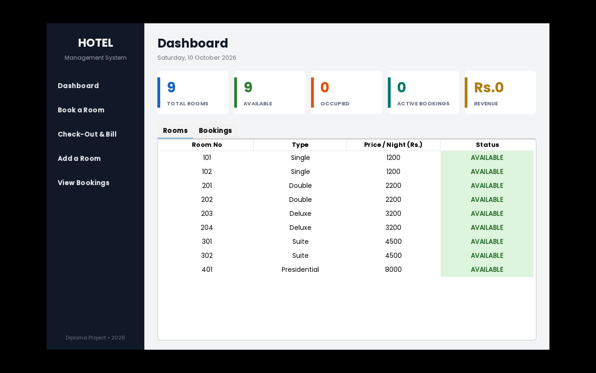
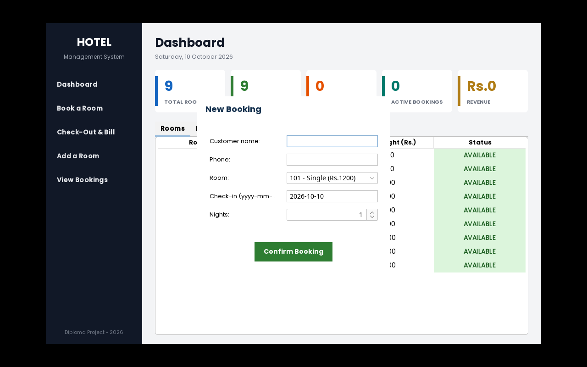
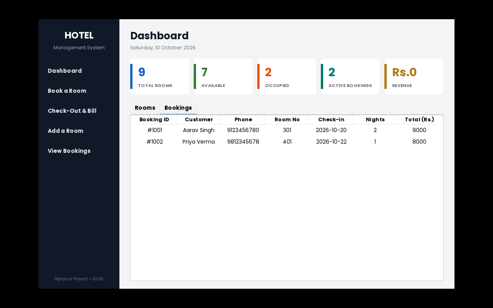
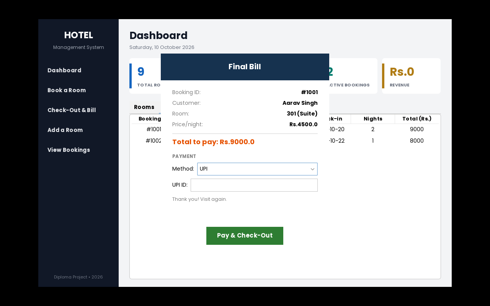
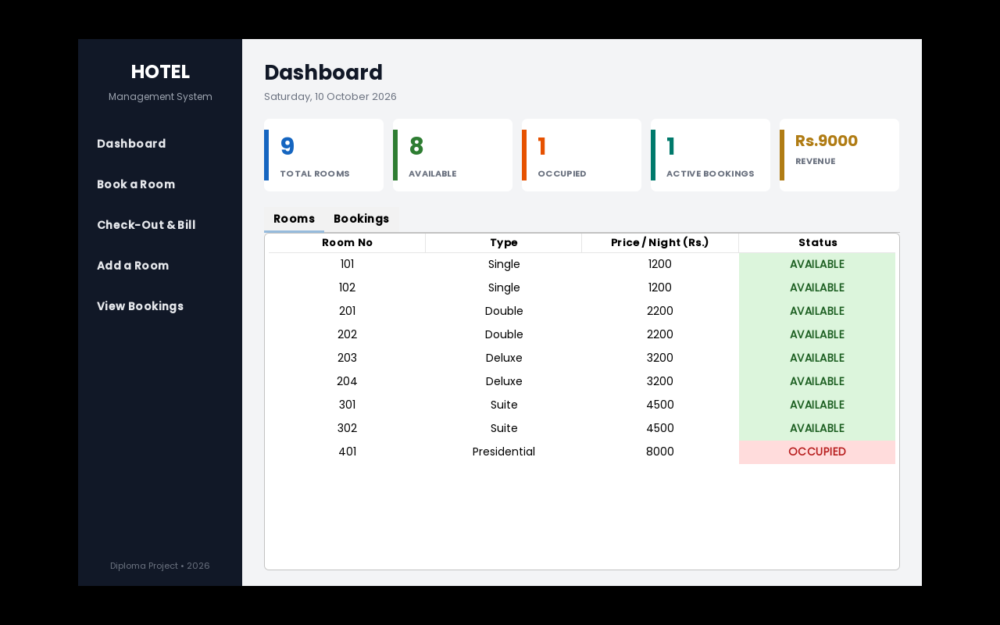

# Hotel Management System (GUI)

A **modern, web-dashboard style** Hotel Management System built in Java Swing.
Dark sidebar navigation, stat cards, colour-coded room table, booking forms
and automatic billing — everything with a clean, classy look.

Built as my second-year diploma project (Computer Science & Engineering,
Govt Polytechnic Sikandra).

## Screenshots


*Dashboard — sidebar navigation, stat cards, colour-coded room table*


*Booking form — only available rooms are listed*


*All active bookings in one table*


*Final bill with payment options (UPI selected)*


*Revenue card updates after every check-out*

## Screens

- **Dashboard** — sidebar navigation, stat cards (total / available /
  occupied / bookings), Rooms and Bookings tabs
- **Booking dialog** — form with customer details, room dropdown, date, nights
- **Bill dialog** — final bill with total at check-out

## Features

- View all rooms in a colour-coded table (green = available, red = occupied)
- View all active bookings in a separate tab
- Book a room via form dialog (only available rooms listed)
- Add new rooms
- Check-out with automatic bill dialog
- **Payment options**: Cash, UPI, Credit Card, Debit Card, Net Banking —
  with UPI ID / card number / bank detail fields
- **Revenue tracker**: dashboard card shows total collected
- Input validation (bad dates, duplicate rooms, bad booking IDs)

## Project structure

```
src/com/hotel/
├── Room.java          # room model
├── Booking.java       # booking model with auto bill
├── HotelManager.java  # all hotel operations (backend)
└── gui/
    ├── HotelGUI.java      # main dashboard window
    ├── BookingDialog.java # booking form
    ├── BillDialog.java    # bill at check-out
    └── DemoShots.java     # screenshot test driver (not part of the app)
lib/
└── flatlaf.jar        # FlatLaf modern look-and-feel (MIT licence)
fonts/
├── Poppins-Regular.ttf
├── Poppins-SemiBold.ttf
└── Poppins-Bold.ttf     # UI font (Open Font License)
```

## How to run

You need **Java 17+** installed.

**Windows (Command Prompt):**
```bat
javac -cp lib\flatlaf.jar -d out src\com\hotel\*.java src\com\hotel\gui\*.java
java -cp "out;lib\flatlaf.jar" com.hotel.gui.HotelGUI
```

**Linux / Mac:**
```bash
javac -cp lib/flatlaf.jar -d out $(find src -name '*.java')
java -cp "out:lib/flatlaf.jar" com.hotel.gui.HotelGUI
```

## Concepts used

- OOP: classes, objects, encapsulation
- Java Swing: `JFrame`, `JDialog`, `JTable`, custom cell renderers
- FlatLaf look-and-feel for a modern UI
- `ArrayList`, `LocalDate`, event listeners (`ActionListener`)
- Separation of backend (`HotelManager`) and UI (`gui` package)

---
*Small record, but it is mine.* ✨
